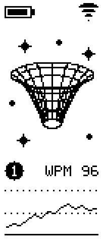

# Corne wireless

**Colemak. Two halves. A little spacetime.**

  

- **Colemak layout** with four layers
- **MiP display** with spacetime artwork, battery level, connection status, active Bluetooth profile, and typing-speed history.
- **Right-hand rotary encoder** for knob control.